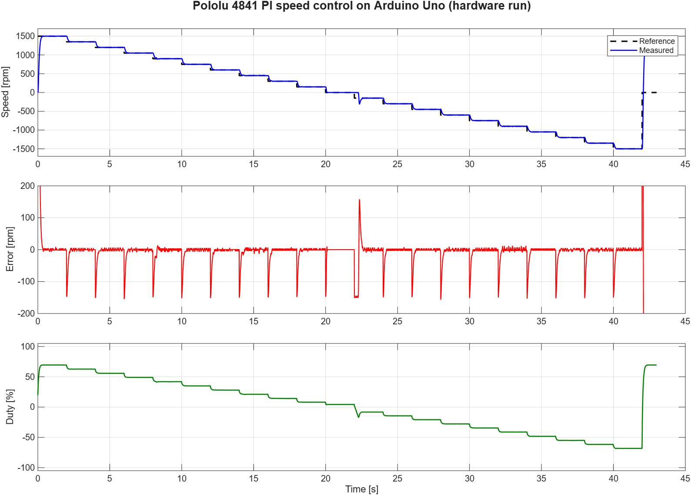

# DC Motor PI Speed Control - Hardware Results

Arduino Uno, BTS7960 driver, Pololu 4841 (4.4:1, 12 V), encoder on D2/D3, Ts = 10 ms.

## Controller

| Item | Value |
|---|---|
| Plant (identified) | K = 21.72 rpm/%, tau = 28.6 ms |
| PI gains | Kp = 0.0132 %/rpm, Ki = 0.460 %/(rpm s) |
| Design | pole-zero cancellation, closed-loop tau = 100 ms |
| Output limit | +/-100 % duty, clamping anti-windup |
| Speed calibration | raw / 1.2035 (100 % duty = 2200 rpm) |

## Summary

- Max steady-state error: 0.5 rpm
- Speed noise (std): 1.6-4.5 rpm
- Median overshoot: 3.7 %, median settling: 0.17 s
- Duty range used: -68.4 to 69.6 %
- Note: 0 -> -150 rpm step from standstill overshoots (static friction breakaway).

## Per-step results

| Ref [rpm] | SS error [rpm] | Noise std [rpm] | Overshoot [%] | Settling [s] |
|---:|---:|---:|---:|---:|
| 1500 | 0.0 | 2.3 | 0.4 | 0.21 |
| 1350 | 0.0 | 2.0 | 3.0 | 0.16 |
| 1200 | -0.1 | 3.1 | 3.7 | 0.17 |
| 1050 | 0.2 | 3.0 | 4.4 | 0.17 |
| 900 | -0.3 | 2.8 | 8.3 | 0.26 |
| 750 | -0.0 | 3.4 | 2.7 | 0.18 |
| 600 | 0.1 | 1.6 | 3.4 | 0.16 |
| 450 | -0.1 | 3.7 | 4.1 | 0.27 |
| 300 | -0.1 | 2.5 | 4.9 | 0.21 |
| 150 | 0.1 | 1.9 | 2.4 | 0.16 |
| 0 | 0.0 | 0.0 | 6.3 | 0.07 |
| -150 | -0.1 | 3.2 | 104.6 | 0.53 |
| -300 | 0.1 | 2.6 | 4.6 | 0.17 |
| -450 | 0.1 | 2.9 | 2.2 | 0.16 |
| -600 | -0.1 | 2.9 | 6.0 | 0.18 |
| -750 | 0.1 | 2.9 | 3.6 | 0.18 |
| -900 | -0.1 | 4.5 | 7.5 | 0.17 |
| -1050 | 0.1 | 2.3 | 1.9 | 0.20 |
| -1200 | -0.5 | 3.0 | 2.6 | 0.17 |
| -1350 | 0.1 | 3.0 | 3.3 | 0.15 |
| -1500 | -0.1 | 2.7 | 4.1 | 0.16 |
