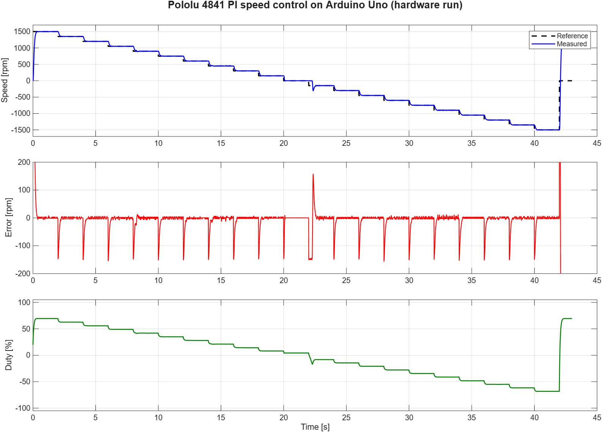

# DC Motor Speed Control on Arduino Uno – Session Documentation

Date: 2026-11-22
Tools: MATLAB / Simulink R2026b Update 1, Simulink Support Package for Arduino Hardware 26.2.4, MATLAB and Simulink Agentic Toolkits
Project: `DCMotorFSSympoLive.prj`

## 1. Goal

Build a Simulink speed controller for a real DC motor running on an Arduino Uno:

- Reference range −1500 … +1500 rpm.
- Speed measured with the motor's quadrature encoder.
- Use the existing BTS7960 driver subsystem (`DC7960MDriver.slx`) without changing it.
- First run open-loop at ±100 % PWM to calibrate the speed measurement, then close the loop with a **PI Controller block**.
- Test profile: 1500 rpm stepping down to −1500 rpm, about 150–200 rpm every 2 s.

## 2. Hardware

| Component | Details |
|---|---|
| Controller | Arduino Uno (ATmega328P, 16 MHz), USB on COM7 |
| Motor | Pololu 4841: 4.4:1 Metal Gearmotor 25Dx63L HP 12 V with 48 CPR encoder. 2200 rpm no-load at 12 V, 300 mA no-load current, 5 A stall (extrapolated) |
| Encoder | Channel A on D2, channel B on D3 (both interrupt pins). 48 counts/rev on the motor shaft → **211.2 counts/rev on the output shaft** |
| Driver | BTS7960 module. D8 and D9 are the enable pins (held high). PWM on D11 for positive duty, on D10 for negative duty, 490 Hz |
| Current sensor | ACS712-5A on A3. Logged only, not used by the controller |
| Supply | 12 V to the driver |

## 3. Project structure and files

| File | Purpose |
|---|---|
| `01_Implementation/DC7960MDriver.slx` | Your BTS7960 driver (Subsystem Reference). Not modified. Input: duty −100 … +100 % |
| `01_Implementation/EncoderSpeed.slx` | Subsystem Reference: encoder counts → speed in rpm |
| `01_Implementation/CurrentSense.slx` | Subsystem Reference: ADC reading on A3 → sensor voltage and current |
| `01_Implementation/DCMotorOpenLoop.slx` | Milestone 1: open-loop duty test model |
| `01_Implementation/DCMotorSpeedControl.slx` | Milestone 3: closed-loop PI speed control (the main model) |
| `01_Implementation/DCMotorParams.m` | All parameters. Loaded by each model's PreLoadFcn and InitFcn |
| `01_Implementation/RunOpenLoopTest.m` | Builds, downloads and runs the open-loop test in Monitor & Tune, then saves the logged data |
| `01_Implementation/IdentifyMotorPlant.m` | Fits a motor model to the open-loop data |
| `01_Implementation/ReportClosedLoop.m` | Plots the closed-loop run and writes `M3_ClosedLoopResults.md` |
| `01_Implementation/OpenLoopTestData_Run1.mat` | Raw open-loop run, logged before the speed calibration was added. `OpenLoopTestData.mat` is an identical copy |
| `01_Implementation/MotorPlantModel.mat` | Identified motor models (`mP1`, `mP1D`, `mP2D`) and the steady-state speed table |
| `01_Implementation/ClosedLoopTestData.mat` | Closed-loop hardware run |
| `02_SupportingArtifacts/ImplementationPlan.md` | The milestone plan agreed at the start of the session |
| `02_SupportingArtifacts/M3_ClosedLoopResults.md` | Closed-loop results report |
| `02_SupportingArtifacts/*.png` | Figures (see sections 7 and 8) |
| `03_Cache`, `04_Codegen` | Simulink cache and generated code, as configured in the project |

All models and scripts are registered in the project, and `01_Implementation` is on the project path.

## 4. How the session went

1. **Planning.** I inspected the project, the toolboxes, the driver subsystem and the motor datasheet, then wrote a three-milestone plan with gates (`ImplementationPlan.md`). You approved it.
   - M1: open loop and calibration.
   - M2: PI tuning in simulation.
   - M3: closed loop on the hardware.
2. **Toolkit setup.** The Simulink Agentic Toolkit's model-building skill checks for custom block libraries first. You confirmed there are none, so no `.satk` files were created and only built-in and Arduino support package blocks were used.
3. **M1: open loop.**
   - I created `EncoderSpeed`, `CurrentSense` and `DCMotorOpenLoop`.
   - I configured the model for the Arduino Uno and checked a build-only (no download). It fits: 79 % flash, 75 % RAM.
   - I ran the 23 s duty sequence on the motor with your go-ahead.
4. **Calibration decision.**
   - The measured speed at ±100 % was about 2648 rpm, 1.2× the datasheet's 2200 rpm.
   - I proposed extra tests to find out why. You chose to assume 100 % duty = 2200 rpm, so a division block (`CalDivide`, divisor 1.2035) was added to `EncoderSpeed`.
5. **Motor model.** I fitted a model of the motor's response from the calibrated open-loop data.
6. **M3: closed loop on the motor.** You were presenting live and asked to skip M2 and the documentation.
   - I designed the PI gains directly from the motor model.
   - I built `DCMotorSpeedControl` and ran the full profile on the motor.
7. **Report.** `ReportClosedLoop.m` plots reference vs. measured speed, tracking error and duty, and writes `M3_ClosedLoopResults.md`.
8. **Post-processing.** I analysed the one poor step (0 → −150 rpm) and found the cause: static friction (section 9). No fix was applied.

## 5. Model architecture

### EncoderSpeed (Subsystem Reference)

```
Encoder block (arduinosensorlib, D2/D3, Ts) ── int32 counts ──┬────────────────────────────────> EncCounts
                                                              ├─ (+) ┐
                                         Delay N = 5 samples ─┴─ (−) ┴─ Δcount → double
    → Gain 60/(211.2·N·Ts)·DirSign → CalDivide (1/1.2035) → Speed_rpm
```

- The speed is the change in count over a 50 ms window (5 samples).
- The resolution is 5.68 rpm per count before calibration, about 4.7 rpm per count after.

### CurrentSense (Subsystem Reference)

`Analog Input A3` (uint16) → double → ×5/1023 → `Sensor_V` → −3.54 V offset → ÷0.185 V/A → 1st-order low-pass filter (a = 0.2) → `Current_A`

### DCMotorOpenLoop

`Repeating Sequence Interpolated` (duty steps, held between steps) → `DutyEnable` gain → saturation ±100 % → `BTS7960_Driver`

`EncoderSpeed` and `CurrentSense` are logged.

### DCMotorSpeedControl (main model)

```
SpeedReference ──(+)── SpeedError ── PI_SpeedController ── DutyLimit ±100 % ── BTS7960_Driver
                  (−)                (Discrete PID block, PI,
                   │                  output limit ±100 %, clamping anti-windup)
                   └──────────── EncoderSpeed.Speed_rpm
```

### Target configuration (both hardware models)

- Hardware board: Arduino Uno.
- Fixed-step discrete solver, Ts = 10 ms, single-tasking.
- Monitor & Tune (External mode), XCP over serial at 921600 baud, port detected automatically.
- Overrun indicator: on-board LED on D13 lights if the 10 ms task overruns.
- Signal logging is on (`logsout`).

## 6. Key parameters (`DCMotorParams.m`)

| Parameter | Value | Meaning |
|---|---|---|
| `Ts` | 0.01 s | Sample time |
| `Enc_CPR_Output` | 211.2 | Counts per output-shaft revolution |
| `Spd_WindowN` | 5 | Speed difference window (50 ms) |
| `Spd_CalDivisor` | 1.2035 | 2647.6 / 2200, so that 100 % duty reads 2200 rpm |
| `Cur_Offset_V` | 3.54 V | ACS712 output at zero current, measured (datasheet says 2.5 V) |
| `Plant_K`, `Plant_Tau` | 21.72 rpm/%, 28.6 ms | Identified motor model |
| `Spd_Tcl` | 0.10 s | Target closed-loop time constant |
| `PI_Kp` | 0.0132 %/rpm | Kp = τ / (K·Tcl) |
| `PI_Ki` | 0.460 %/(rpm·s) | Ki = 1 / (K·Tcl) |
| `Ref_Levels` | 1500 : −150 : −1500 | 21 levels, 2 s each, then 0. Stop time 43 s |

## 7. Milestone 1: open-loop results

Steady-state values are the mean over the last 40 % of each step.

| Duty [%] | Raw speed [rpm] | Calibrated speed [rpm] | Noise std [rpm] | ACS712 [V] |
|---:|---:|---:|---:|---:|
| 0 | 0 | 0 | 0 | 3.542 |
| +25 | 634.7 | 527.4 | 2.8 | 3.635 |
| +50 | 1287.2 | 1069.6 | 2.8 | 3.689 |
| +75 | 1954.0 | 1623.7 | 2.2 | 3.757 |
| +100 | 2632.2 | 2187.2 | 3.8 | 3.817 |
| −25 | −637.9 | −530.1 | 2.6 | 3.627 |
| −50 | −1301.7 | −1081.6 | 2.3 | 3.698 |
| −75 | −1982.0 | −1647.0 | 2.3 | 3.748 |
| −100 | −2663.0 | −2212.8 | 3.0 | 3.811 |

What the data shows:

- **Direction:** correct, positive duty gives positive rpm (`Enc_DirSign = +1`).
- **Linearity and symmetry:** speed is very close to proportional to duty, and the two directions agree within 1.2 %.
- **Speed scale:** the raw reading was 1.2× the datasheet. The cause was not investigated, because you chose to scale it to 2200 rpm.
- **Current sensor:** it rests at 3.54 V instead of 2.5 V, and the reading rises in **both** directions. It is therefore measuring the driver's supply current, not the motor current. The datasheet sensitivity (0.185 V/A) has not been checked, so treat `Current_A` as an uncalibrated indication only.

Motor model fitted from the data (System Identification Toolbox, fitted on the positive-duty half, checked on the negative-duty half):

| Model | Check fit | Parameters |
|---|---:|---|
| 1st order (P1) | 95.4 % | — |
| **1st order + delay (P1D)** | **96.9 %** | K = 21.72 rpm/%, τ = 28.6 ms, delay = 17.9 ms |
| 2nd order + delay (P2D) | 96.9 % | K = 21.71 rpm/%, τ1 = τ2 ≈ 21 ms, delay = 7.4 ms |

The delay mostly comes from the 50 ms speed-measurement window.

Figures: `M1_OpenLoop_Run1.png` and `M1_PlantID_Validation.png`.

## 8. Milestone 3: closed-loop results on the motor



| Metric | Result |
|---|---|
| Steady-state error | within ±0.5 rpm at all 21 levels |
| Speed noise (std) | 1.6–4.5 rpm |
| Overshoot | median 3.6 %, 0.4–8.3 % on every step except 0 → −150 rpm |
| Settling time (5 % band, at least ±15 rpm) | median 0.17 s, 0.15–0.27 s |
| Duty used | −68.4 % … +69.6 %, never hit the ±100 % limit |
| 0 → −150 rpm (start from standstill) | 104.6 % overshoot (peaks at −307 rpm), settles in 0.53 s |

Per-step table: `M3_ClosedLoopResults.md`.

## 9. Why the 0 → −150 rpm step overshoots

Figure: `M3_StandstillStartZoom.png`.

1. **The integrator gets stuck at 0 rpm.** While slowing from 150 to 0 rpm, the motor sticks and stops with the controller still sending +4.3 % duty. The measured speed is exactly 0, so the error is 0 and the integrator stays frozen at +4.3 %.
2. **The step is too small to start the motor quickly.** At the step to −150 rpm, the proportional part is only 150 × 0.0132 ≈ 2 %. The integrator has to ramp the duty, at about 69 %/s, from +4.3 % through 0 to the breakaway level.
3. **Stall, then breakaway.** The motor stays still for **0.30 s**. It doesn't move at −14.7 % and breaks free at **−16.6 %**. Once moving it only needs about −8 % to hold 150 rpm, so the extra ~8 % duty throws the speed to −307 rpm. The 50 ms speed window adds lag before the controller reacts.
4. **The first start is the counterexample.** The 0 → 1500 rpm step at t = 0 also starts from standstill. There the proportional part is about 20 %, above the breakaway level. The motor moved after 0.02 s (at 33 % duty) and overshot only 0.4 %.

This points to static friction: about 16.6 % duty is needed to start, but only about 8 % to keep turning at 150 rpm. A dead band at low duty in the driver would look the same in this data and has not been ruled out. A slow open-loop duty ramp from 0 to ±25 % would tell the two apart.

Possible fixes (not applied, by your decision):

- Reset the integrator when the reference is 0.
- Add a feedforward term: ref / K plus a friction offset in the direction of the reference.
- Add a breakaway kick: when the reference isn't 0 but the speed is about 0, briefly add roughly ±12 % duty.
- Shorten the speed window to 3 samples. This reduces lag but makes the speed noisier.

## 10. Differences from the plan and open items

- **Milestone 2 (simulation tuning) was skipped**, at your request during the live presentation. `SpeedController.slx` and `DCMotorPlantSim.slx` from the plan were not created. The PI controller is a block directly in `DCMotorSpeedControl`, and its gains came from the motor model by calculation, not from a simulated tuning loop.
- **The gates were not formally signed off.** M1 was accepted implicitly ("the rpm looks fine"). M3 ran successfully.
- **The speed calibration is an assumption**, not a root-cause fix. Two causes are still possible: (a) the encoder counts per revolution differ from the datasheet, or (b) the 10 ms task overruns, which would make each measurement window longer than assumed. Ways to check:
  - Turn the output shaft by hand exactly 10 times: it should give 2112 counts.
  - Time the target against wall-clock during a run.
  - Watch the D13 LED during a run (it lights on overrun).
- **The reference signal was not logged** in the closed-loop run (the logging flag was lost when the line was renamed). The report rebuilds the reference from `Ref_Time` and `Ref_Values`.
- **Leftovers copied from the open-loop model:** the scope in `DCMotorSpeedControl` is still named `Scope_OpenLoop` and doesn't show the reference.
- **`RunOpenLoopTest.m`** was extended with an optional `olRunCfg` struct (duty gain, stop time, data file) and wall-clock timing. That extended version has not been run on the hardware.
- **Git:** registering the files in the project also staged them in git. Nothing was committed. `04_Codegen/` shows as untracked (generated code, probably worth adding to `.gitignore`). The `*.slx.autosave` files are already ignored.

## 11. How to reproduce

```matlab
% open the project, then:
DCMotorParams;
run('01_Implementation/RunOpenLoopTest.m')     % open-loop test on hardware (motor spins up to ±100 %)
run('01_Implementation/IdentifyMotorPlant.m')  % motor model from OpenLoopTestData_Run1.mat
open_system('DCMotorSpeedControl')             % closed loop: Hardware tab → Monitor & Tune
run('01_Implementation/ReportClosedLoop.m')    % plots and report from ClosedLoopTestData.mat
```

Before any run on the hardware: motor clamped, shaft free, 12 V driver supply on, Uno connected by USB.
